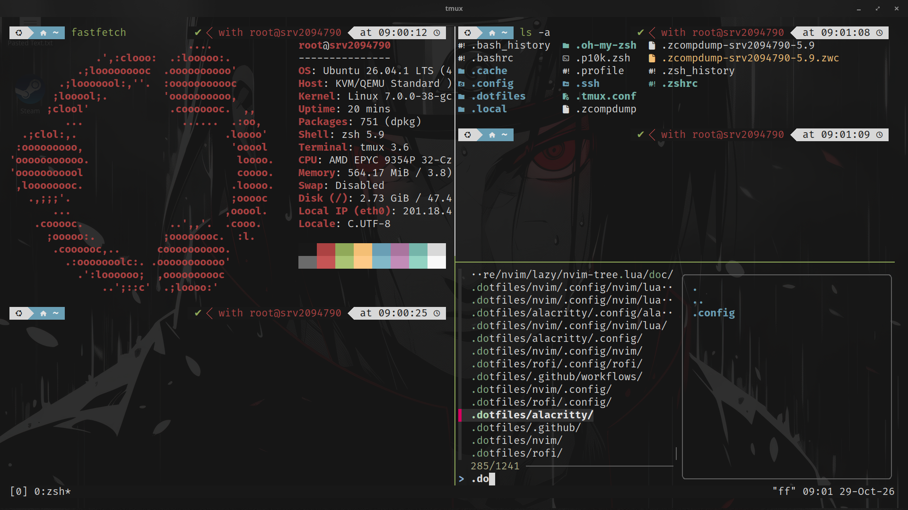

# Dotfiles

Dotfiles configuration for a development environment on a VPS (Debian/Ubuntu).

## Overview

- **zsh** — Zsh + Oh My Zsh + Powerlevel10k + plugins (zsh-syntax-highlighting)
- **tmux** — tmux configuration
- **nvim** — Neovim + NvChad (installed by `setup.sh`, not versioned here)
- **rofi** — Rofi launcher theme (desktop GUI only, not stowed yet)
- **alacritty** — Alacritty terminal configuration (desktop GUI only, not stowed yet)
- **setup.sh** — automated system packages and dotfiles installation

> **Note:** `rofi` and `alacritty` are desktop GUI applications only. They
> are not linked via Stow yet and are intended for a machine with a desktop
> environment — not a headless VPS.

## Screenshots



## Requirements

- Debian / Ubuntu
- `sudo` access
- Internet connection

## Usage

### Full installation

1. Clone the repository:

   ```sh
   git clone git@github.com:ren-zi-fa/.dotfiles.git ~/.dotfiles
   ```

2. Run the setup script:

   ```sh
   cd ~/.dotfiles && chmod +x ./setup.sh && ./setup.sh
   ```

   The script installs system packages (including Docker, fastfetch, htop,
   bmon, and cron), sets the timezone to Asia/Jakarta, installs eza, Neovim,
   NvChad, Oh My Zsh, Powerlevel10k, zsh plugins, Composer, and tldr; links
   the dotfiles to `$HOME` using GNU Stow; adds the user to the `docker`
   group; then sets zsh as the default shell.

3. Apply the changes:

   Log out and log back in (or reboot). This makes the new default shell
   and the `docker` group membership take effect.

4. Finish the NvChad setup:

   ```sh
   nvim
   ```

   Wait for lazy.nvim to finish downloading plugins, then run
   `:MasonInstallAll` and `:TSInstallAll`.

### Link dotfiles only (without installing packages)

```sh
cd ~/.dotfiles
stow --dir="$HOME/.dotfiles" --target="$HOME" tmux zsh
```

This links `tmux` and `zsh` only. NvChad is installed by `setup.sh` (see
above) rather than linked, and `rofi`/`alacritty` are desktop GUI configs
that are not linked here.
